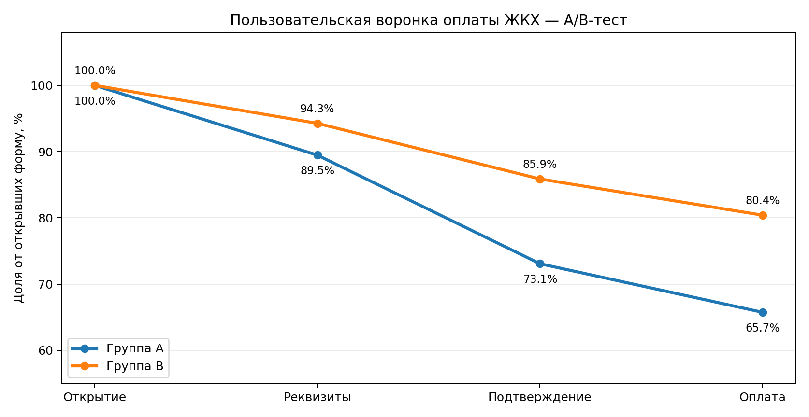

# A/B-тест новой формы оплаты ЖКХ

**Продуктовая аналитика | Python | A/B Testing**

## О проекте

Анализ результатов A/B-теста новой формы оплаты коммунальных услуг с упрощённым заполнением реквизитов.

**Цель:** определить, увеличивает ли новая форма конверсию из открытия формы в успешную оплату, и принять решение о её масштабировании.

Период эксперимента: 1–30 апреля 2024 года.

## Основные результаты

| Метрика | Группа A | Группа B |
|---|---:|---:|
| Пользователи, открывшие форму | 750 | 750 |
| Конверсия в успешную оплату | 65,73% | **80,40%** |
| Успешность первой попытки | 50,80% | **65,73%** |

**Основной результат: +14,67 п.п. к пользовательской конверсии (+22,31% относительно A).**

- P-value: 1,53 × 10⁻¹⁰
- 95% доверительный интервал эффекта: [+10,21; +19,05] п.п.
- Эффект статистически значим при α = 0,05.

## Анализ воронки

Наибольшее улучшение условной конверсии наблюдается между вводом реквизитов и подтверждением платежа: **+9,42 п.п.**

Положительная динамика также наблюдается в основных сегментах пользователей по устройствам, городам и возрасту.

При этом медианное время прохождения этапов практически не изменилось. Утверждать, что новая форма ускоряет оплату, на основании имеющихся данных нельзя.

## Методология

- Проверка качества данных, обработка пропусков и аномалий.
- Построение пользовательской и транзакционной воронок.
- Расчёт основных и дополнительных продуктовых метрик.
- Двусторонний Z-тест для сравнения долей.
- Оценка 95% доверительного интервала методом Ньюкомба.
- Сегментный анализ и проверка устойчивости результатов.

**Единица статистического анализа — пользователь**, поскольку рандомизация проводилась на уровне пользователей, а один пользователь мог совершать несколько попыток оплаты.

После очистки данных в исследовании осталось 1 502 пользователя и 2 658 попыток оплаты.

## Продуктовая рекомендация

**Рекомендовано поэтапное внедрение новой формы B до 100% пользователей** с мониторингом защитных метрик.

Перед полным масштабированием необходимо контролировать технические ошибки, повторные списания, возвраты платежей и обращения в поддержку.

Результаты эксперимента подтверждают рост конверсии, но не позволяют однозначно установить механизм этого улучшения.

## Материалы проекта

- [Jupyter Notebook — полный анализ](analysis.ipynb)
- [Итоговый аналитический отчёт (PDF)](report.pdf)

## Инструменты

Python, pandas, NumPy, SciPy, statsmodels, Matplotlib, Google Colab / Jupyter Notebook.

## Воспроизведение

Зависимости перечислены в `requirements.txt`.

Ноутбук можно запустить в Google Colab или локальном Jupyter. Для выполнения расчётов необходим исходный Excel-файл с листами `Пользователи` и `Платежи`.

Исходные данные тестового задания не включены в публичные материалы. Готовые результаты, визуализации и методология доступны для ознакомления.
